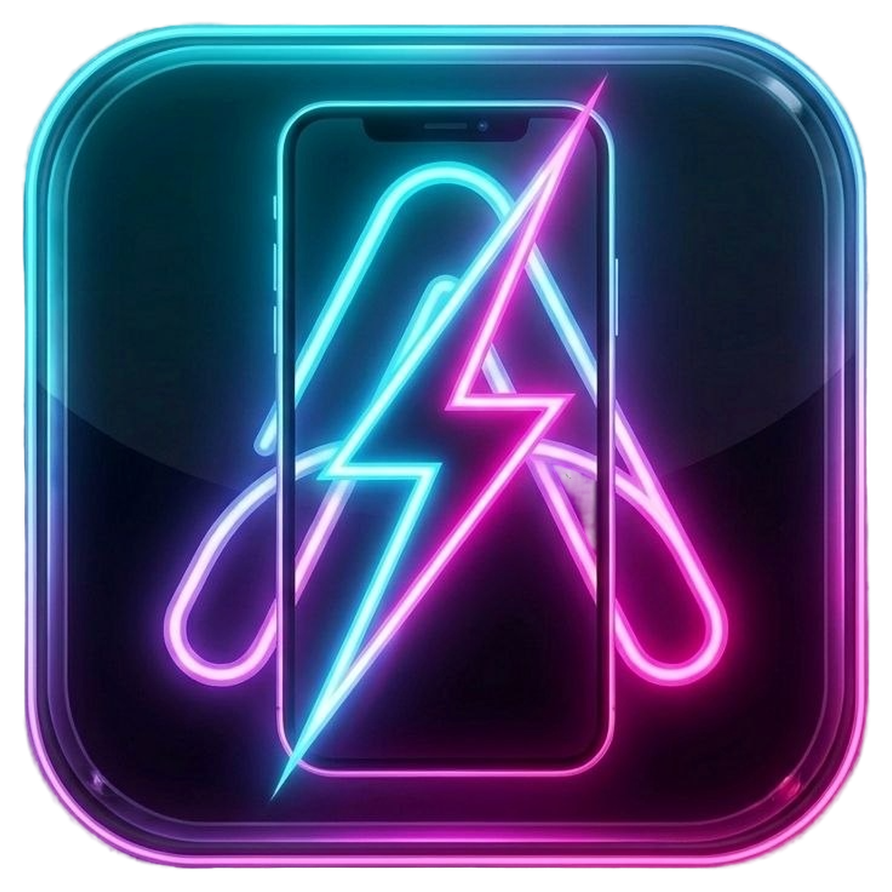

# 🎬 AClipper — Автоматический AI-комбайн для нарезки клипов и стримов

  

  <b>Профессиональное десктопное приложение для стримеров, контент-мейкеров и клипперов.</b> 
  Автоматически находит хайлайты, генерирует караоке-субтитры и монтирует вертикальные клипы (9:16) для <b>TikTok</b>, <b>YouTube Shorts</b>, <b>Instagram Reels</b> и <b>VK Клипы</b>.

---

## ✨ Ключевые возможности

- 🤖 **Локальный искусственный интеллект (Faster-Whisper)**  
  Распознает речь на русском и английском языках прямо на вашем компьютере. Не требует платных API-ключей, интернета для транскрибации и работает полностью конфиденциально.

- ⚡ **Умное автоопределение видеокарты (NVIDIA, AMD, Intel, CPU)**  
  - Программа автоматически сканирует систему при запуске и включает лучшее аппаратное ускорение:
    - **NVIDIA**: аппаратный рендеринг **NVENC** + ускорение распознавания речи через **CUDA**.
    - **AMD Radeon**: аппаратное кодирование через **AMD AMF** — отличная скорость монтажа на видеокартах AMD (RX и новее)!
    - **Intel**: поддержка аппаратного кодека **Intel QuickSync (QSV)**.
    - **CPU**: если дискретной видеокарты нет, софт бесшовно работает на оптимизированных инструкциях процессора.

- 🛡️ **Уникализация видео («Анти-шаблон» / Защита от теневых банов)**  
  - Интеллектуальный алгоритм **«Анти-шаблон»**: динамический микро-зум, сдвиг кадрирования и наложение уникальных оверлеев.
  - Полная очистка и рандомизация метаданных медиафайла (новый хэш каждого клипа).
  - Алгоритмы рекомендаций **TikTok, Shorts, Reels и VK** воспринимают каждый смонтированный ролик как **100% уникальный авторский контент**, предотвращая пессимизацию охватов и теневые баны за перезалив.

- 🧠 **Экстремальная оптимизация памяти**  
  Инновационный потоковый алгоритм обработки аудио позволяет обрабатывать записи длительностью **более 6–12 часов**, потребляя всего **до 2.5 ГБ оперативной памяти**. Никаких вылетов из-за переполнения ОЗУ даже в песочницах и на слабых ПК!

- 🎯 **Умный детектор вирусных моментов**  
  Анализирует текст и контекст речи, автоматически выделяя эмоциональные, смешные и ключевые моменты стрима.

- 🎨 **Караоке-субтитры с анимацией**  
  Генерация субтитров со словесным таймингом, подсветкой активного слова, автоматическим переносом строк и кастомизацией стилей.

- 📐 **Адаптивный авто-монтаж (9:16)**  
  Удобные пресеты компоновки: «Игра сверху / Вебка снизу», авто-кроп по центру, сглаживание динамики и умное кадрирование.

- 🎨 **Наложение HUD-баннеров стримера**  
  Индивидуальная настройка оверлеев, логотипов и плашек для каждого стримера с привязкой координат.

- 📥 **Многопоточный загрузчик (yt-dlp)**  
  Поддержка скачивания сотен VOD и клипов с Twitch, YouTube, Kick в несколько потоков с поддержкой прокси.

- 🔄 **Встроенная система обновлений**  
  Автоматическая проверка новых релизов с поддержкой бесшовных патчей.

---

## 💻 Чтобы работало (Системные требования)

- **ОС**: Windows 10 / 11 (64-bit)
- **Процессор**: от 4 ядер (Intel Core или AMD Ryzen)
- **Оперативка**: от 4 ГБ (лучше 8 ГБ)
- **Видяха**: любая — NVIDIA, AMD Radeon, Intel или встроенная (софт сам определит GPU и включит подходящее ускорение)
- **Место на диске**: ~3 ГБ

---

## 🚀 Установка

1. Перейдите во вкладку [**Releases**](https://github.com/Acll0/AClipper/releases).
2. Скачайте последнюю версию инсталлятора **`AClipper_Setup.exe`**.
3. Запустите файл и следуйте простым инструкциям установщика.
4. Программа автоматически установится и создаст ярлык на рабочем столе.

---

## 🔒 Безопасность и конфиденциальность

- Все модели ИИ запускаются **строго локально** на вашей машине.
- Ваши видео, аудиозаписи и стримы никуда не отправляются.
- Исполняемые модули защищены и оптимизированы для стабильной работы.

---

  Разработано с ❤️ командой AClipper

